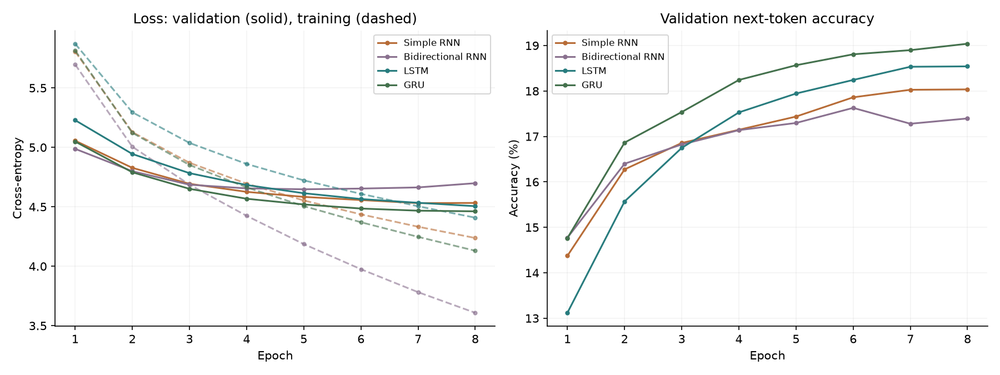
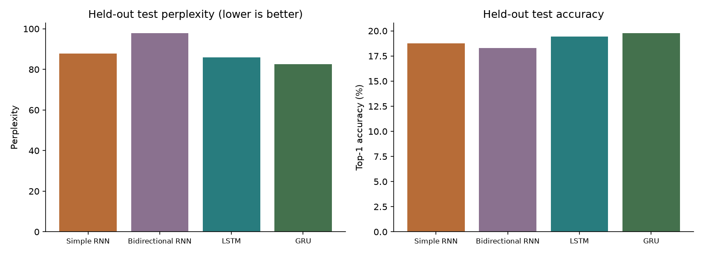
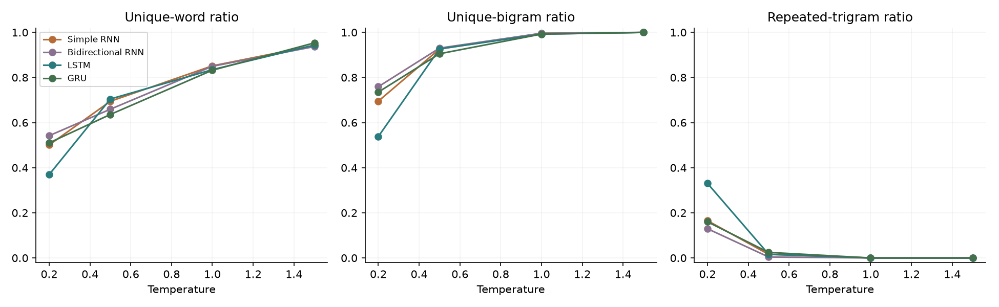

# Experiment report

Created: 2026-10-17T19:22:14.516906+00:00

Training device: `cpu`. Corpus: 120,630 tokens. Vocabulary: 3,926 tokens fitted only on the training split.

The token stream is split sequentially 80%/10%/10% before sliding windows are constructed. The vocabulary includes an unknown token; test metrics include unknown-token targets. See dataset.json for each split's unknown rate. Perplexity measures this tokenized vocabulary, so it should only be compared between runs with the same preprocessing and vocabulary.

| Model | Best epoch | Validation loss | Test loss | Test perplexity | Top-1 | Top-5 | Training (s) |
|---|---:|---:|---:|---:|---:|---:|---:|
| Simple RNN | 7 | 4.531 | 4.474 | 87.7 | 18.7% | 42.5% | 238.5 |
| Bidirectional RNN | 5 | 4.648 | 4.584 | 97.9 | 18.3% | 41.2% | 179.2 |
| LSTM | 8 | 4.506 | 4.454 | 85.9 | 19.4% | 42.6% | 334.7 |
| GRU | 8 | 4.462 | 4.414 | 82.6 | 19.8% | 43.4% | 470.3 |

**Selected model: GRU**, based on the lowest validation loss. Test results are reported after selection of each model's best validation checkpoint.

## Temperature experiment

All models use the same three prompts, temperatures (0.2, 0.5, 1.0, 1.5), and sampling seeds. Top-k and top-p filtering are disabled here to isolate temperature. Diversity and repetition metrics are descriptive; they do not establish story coherence or factual accuracy.

## Unedited generated samples

### Simple RNN at temperature 0.5

Prompt: sherlock holmes looked at me and said

> he was an ulster, and i have a sovereign that the man was not for the time of the case of the way, and my sister. they are all that i am to be a little of the case of the hotel, said he, the

### Simple RNN at temperature 1.0

Prompt: sherlock holmes looked at me and said

> upon the young ulster rope savannah my her avenue, and a hundred carbuncle would was over with the conduct. holmes! usually the note, you have been in her sherlock holmes, he might. for know perhaps, then very features, said it, the

### Bidirectional RNN at temperature 0.5

Prompt: sherlock holmes looked at me and said

> he and his eyes shining the first, and the lady of the church, and i had no doubt that the other was a very much indebted to the window, which i am afraid in the case, and i came very well, said holmes, and

### Bidirectional RNN at temperature 1.0

Prompt: sherlock holmes looked at me and said

> upon his mouth. but savannah my her cripple, feeling, i was not for that he had conduct money the curious than which i saw you have been in her mistress my friend he might prove for know mark. there's very features, said holmes, the

### LSTM at temperature 0.5

Prompt: sherlock holmes looked at me and said

> he was an ulster in the first, and the name of the other would have a few minutes with the room. i have seen my own, but i have no doubt, he remarked. i know that i came to do, said holmes, and

### LSTM at temperature 1.0

Prompt: sherlock holmes looked at me and said

> upon his mouth. but savannah my her cripple for mrs. k. try was to ask you conduct. holmes! usually over into my uncle, they in her mistress my father he impulse. india know perhaps, then very features, said he, and

### GRU at temperature 0.5

Prompt: sherlock holmes looked at me and said

> he. no, but i have her back for the case. you have seen to the police. you have no doubt that you will do you. i have no doubt you to say. i know that i have very much to this matter. i

### GRU at temperature 1.0

Prompt: sherlock holmes looked at me and said

> upon his mouth. but savannah out her back for me, i was surprised for that than things conduct. the whole usually over into my face, they found her sherlock my father he might save for upon the other of very features, and it had sister

## Interpretation and limitations

These small models learn local vocabulary and phrase patterns, but can repeat themselves and lose long-range meaning. A few epochs on a CPU are a demonstration, not evidence of polished story generation. Unknown words, a single book, a fixed context window, and a single training seed limit this experiment. Accuracy includes punctuation. Model sizes differ even when hidden dimensions are equal. Training times include validation and checkpoint writes and reflect current machine load; they are not controlled speed benchmarks. More rigorous comparisons should repeat training with several seeds and report uncertainty.

Inspect the actual samples alongside loss and perplexity; do not infer human-level writing quality from either metric.
